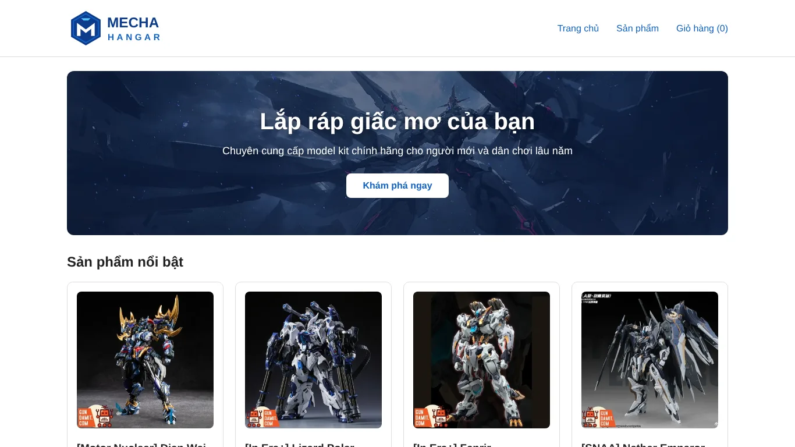
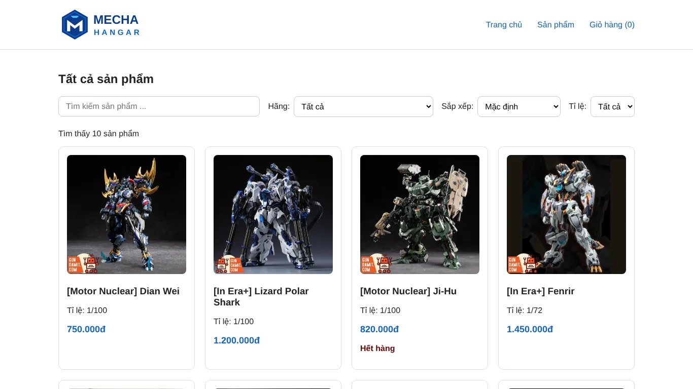
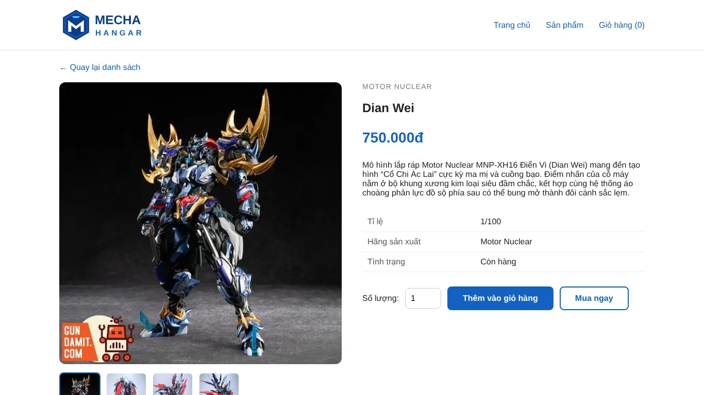
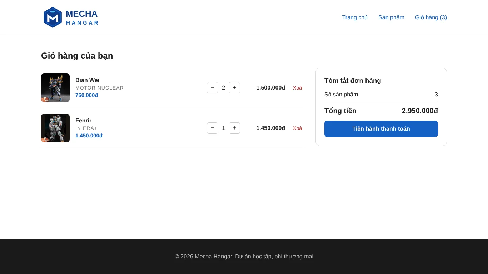
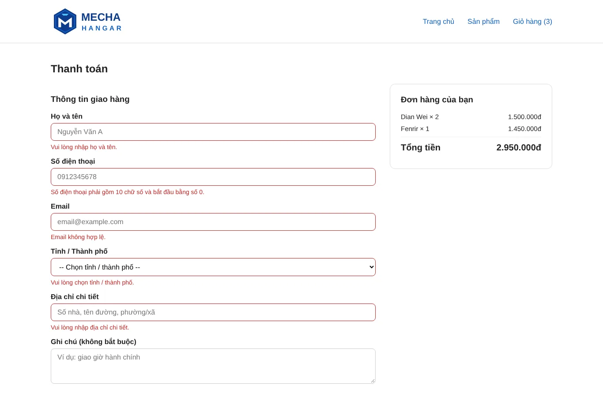
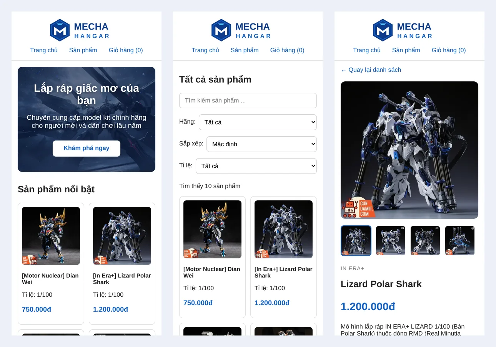

# Mecha Hangar

Website thương mại điện tử bán mô hình lắp ráp (model kit) mecha, xây dựng bằng **HTML, CSS và JavaScript thuần**, không dùng framework hay thư viện.

**Demo:** https://tuelinh1910.github.io/mecha-shop/



## Giới thiệu

Hiện nay bộ môn sưu tầm Mecha Model Kit vốn dĩ không còn xa lạ với cộng đồng người chơi tại Việt Nam nữa. Cách đây hàng chục năm về trước cái tên Bandai đã làm mưa làm gió trên thị trường với những mẫu Gundam chất lượng, và giờ đây các hãng Trung Quốc cũng không kém cạnh khi phát triển các mẫu Mecha Tiên Hiệp, Mecha cơ khí, .... đậm chất riêng. Tuy nhiên thì để sở hữu một mẫu model kit ưng ý thì người chơi phải bỏ ra kha khá tài chính do order trực tiếp từ nước ngoài, và có nhiều người thậm chí còn không biết cách hay nguồn uy tín để làm việc đó. Nhằm hỗ trợ và giúp người chơi tại Việt Nam tiếp cận dễ hơn với các mẫu sản phẩm mới nhất trên thị trường, trang web Mecha Hangar đã được tạo ra để khoảng cách địa lý không còn là vấn đề.

## Tính năng

- **Danh sách sản phẩm** được tạo tự động từ dữ liệu JavaScript
- **Tìm kiếm** theo tên sản phẩm và tên hãng, không phân biệt chữ hoa chữ thường
- **Bộ lọc** theo hãng và tỉ lệ, kết hợp được nhiều điều kiện cùng lúc
- **Sắp xếp** theo giá tăng dần và giảm dần
- **Trang chi tiết dùng chung** cho mọi sản phẩm, đọc id từ đường dẫn (`chi-tiet.html?id=1`)
- **Thư viện ảnh** với ảnh nhỏ bấm để đổi ảnh lớn
- **Giỏ hàng** lưu bằng `localStorage`, không mất dữ liệu khi tải lại trang; tăng, giảm, xoá sản phẩm và tự tính tổng tiền
- **Thanh toán** với form kiểm tra dữ liệu: họ tên, số điện thoại, email, địa chỉ; báo lỗi ngay dưới từng ô
- **Responsive**, hiển thị tốt trên máy tính, máy tính bảng và điện thoại

## Hình ảnh

| Danh sách sản phẩm | Chi tiết sản phẩm |
|---|---|
|  |  |

| Giỏ hàng | Thanh toán |
|---|---|
|  |  |

**Giao diện điện thoại**



## Công nghệ sử dụng

- **HTML5**: thẻ ngữ nghĩa (`header`, `main`, `section`, `aside`, `footer`)
- **CSS3**: Flexbox, Grid, media query, biến đổi bố cục theo kích thước màn hình
- **JavaScript (ES6+)**: thao tác DOM, xử lý sự kiện, `localStorage`, `URLSearchParams`
- **Git & GitHub Pages**: quản lý phiên bản và triển khai website

## Cấu trúc thư mục

```
mecha-shop/
├── index.html          # Trang chủ
├── san-pham.html       # Danh sách sản phẩm
├── chi-tiet.html       # Chi tiết sản phẩm
├── gio-hang.html       # Giỏ hàng
├── thanh-toan.html     # Thanh toán
├── style.css           # Toàn bộ CSS
├── data.js             # Dữ liệu sản phẩm và các hàm dùng chung
├── cart.js             # Xử lý giỏ hàng (dùng chung cho mọi trang)
├── trang-chu.js        # Logic riêng của từng trang
├── san-pham.js
├── chi-tiet.js
├── gio-hang.js
├── thanh-toan.js
├── images/             # Ảnh sản phẩm, banner, logo
└── screenshots/        # Ảnh minh hoạ cho README
```

## Điểm kỹ thuật đáng chú ý

- **Tách dữ liệu khỏi giao diện:** sản phẩm được lưu trong mảng `products` ở `data.js`. Thêm một sản phẩm mới chỉ cần thêm một object, không phải sửa HTML.
- **Giỏ hàng chỉ lưu id và số lượng:** thông tin như giá, tên luôn được tra từ dữ liệu gốc, nên giỏ hàng luôn hiển thị giá mới nhất.
- **Giao diện luôn khớp với dữ liệu:** mỗi thao tác trong giỏ hàng sẽ cập nhật dữ liệu trước, rồi vẽ lại giao diện từ dữ liệu.
- **Ủy quyền sự kiện (event delegation):** các nút trong giỏ hàng và form thanh toán dùng một sự kiện duy nhất gắn ở thẻ cha.
- **Phòng chống XSS:** dữ liệu do người dùng nhập luôn được hiển thị bằng `textContent` thay vì `innerHTML`.

## Chạy project trên máy

1. Tải code về: `git clone https://github.com/TueLinh1910/mecha-shop.git`
2. Mở thư mục bằng VS Code
3. Chuột phải vào `index.html`, chọn **Open with Live Server**

## Hướng phát triển

- Viết lại project bằng React
- Tự động tạo danh sách hãng trong bộ lọc từ dữ liệu
- Kết nối với backend thật để lưu đơn hàng

## Ghi chú
